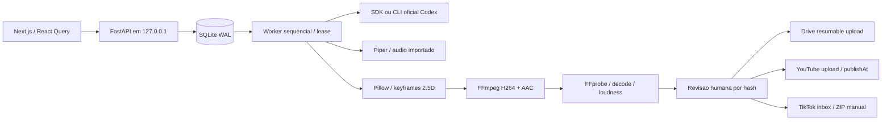

# Arquitetura

`services/api/factory` contem configuracao, modelos SQLAlchemy, schemas Pydantic, API dividida em routers, fila, pipeline, providers, compositor e integracoes HTTP. `services/worker/main.py` inicia o mesmo worker em processo separado; a API ja inicia um worker por padrao. Claims transacionais impedem dois workers de produzir simultaneamente. Nao iniciar varios processos Uvicorn; um e suficiente para 8 GB.

Existem 17 entidades: UserSettings, Channel, Series, Character, SceneAsset, VideoProject, VideoScene, ScriptVersion, Storyboard, ProductionJob, JobEvent, RenderArtifact, QualityReview, PublishingSchedule, PlatformConnection, PlatformPublication, AnalyticsSnapshot.

SQLite ativa WAL, foreign_keys e busy_timeout em cada conexao. Alembic possui revisao inicial 0001. Para banco vazio sem Alembic instalado, a API faz bootstrap SQLAlchemy explicito; isso nao registra migracao ficticia. O setup normal sempre executa Alembic. A revisao inicial contem DDL SQLite congelado, independente dos modelos atuais; futuras alteracoes exigem novas revisoes.

A fila usa `BEGIN IMMEDIATE`, dono UUID, lease de 45s e heartbeat de 10s. Checkpoints JSON guardam resultados de cada agente. Interrupcao exige expirar/reliberar lease; retomada nao repete os agentes ja persistidos. O video incompleto usa `.partial.mp4`, substituido atomicamente no final.

A API publica eventos ordenados com IDs SQLite monotonicos. SSE aceita `Last-Event-ID`; o frontend invalida os dados de servidor e consulta estado persistido. Fechar a web nao encerra o worker. Encerrar o processo API interrompe producao; o proximo processo recupera tarefas apos o lease.

Renderizacao utiliza um frame por vez, threads FFmpeg=2 e uma tarefa. Composicao de audio em disco evita manter videos na RAM. O padrao e 720x1280/24fps, ou 1280x720 para episodios. Demos usam 360x640.

Integracoes sao HTTP oficiais via httpx. Nenhum plugin da conta do desenvolvedor e requisito da aplicacao. Nao se compartilham tokens do Codex com APIs Google/TikTok.
