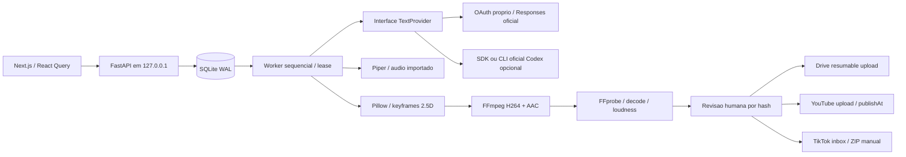

# Arquitetura

O motor visual é independente do provider textual. `visual_config` por projeto/revisão
seleciona `compositor_2d` ou `blender_3d`; a migração mantém os projetos anteriores em
2D. `VisualBoard` é validado antes do checkpoint, e templates Python do repositório
interpretam somente dados. O worker usa frames em disco com cache por hash, seguido
da composição FFmpeg e validação/revisão por hash existentes.
Contrato, configuração, limites e bloqueios de validação: [produção 3D local](LOCAL_3D.md).

`services/api/factory` contem configuracao, modelos SQLAlchemy, schemas Pydantic, API dividida em routers, fila, pipeline, providers, compositor e integracoes HTTP. `services/worker/main.py` inicia o mesmo worker em processo separado; a API ja inicia um worker por padrao. Claims transacionais impedem dois workers de produzir simultaneamente. Nao iniciar varios processos Uvicorn; um e suficiente para 8 GB.

Existem 17 entidades: UserSettings, Channel, Series, Character, SceneAsset, VideoProject, VideoScene, ScriptVersion, Storyboard, ProductionJob, JobEvent, RenderArtifact, QualityReview, PublishingSchedule, PlatformConnection, PlatformPublication, AnalyticsSnapshot.

SQLite ativa WAL, foreign_keys e busy_timeout em cada conexao. Alembic possui revisao inicial 0001. Para banco vazio sem Alembic instalado, a API faz bootstrap SQLAlchemy explicito; isso nao registra migracao ficticia. O setup normal sempre executa Alembic. A revisao inicial contem DDL SQLite congelado, independente dos modelos atuais; futuras alteracoes exigem novas revisoes.

A fila usa `BEGIN IMMEDIATE`, dono UUID, lease de 45s e heartbeat de 10s. Checkpoints JSON guardam resultados de cada agente. Interrupcao exige expirar/reliberar lease; retomada nao repete os agentes ja persistidos. O video incompleto usa `.partial.mp4`, substituido atomicamente no final.

A API publica eventos ordenados com IDs SQLite monotonicos. SSE aceita `Last-Event-ID`; o frontend invalida os dados de servidor e consulta estado persistido. Fechar a web nao encerra o worker. Encerrar o processo API interrompe producao; o proximo processo recupera tarefas apos o lease.

Renderizacao utiliza um frame por vez, threads FFmpeg=2 e uma tarefa. Composicao de audio em disco evita manter videos na RAM. O padrao e 720x1280/24fps, ou 1280x720 para episodios. Demos usam 360x640.

Integracoes sao HTTP oficiais via httpx. Nenhum plugin da conta do desenvolvedor e requisito da aplicacao. Nao se compartilham tokens do Codex com APIs Google/TikTok.

## Autorizacao e provider textual

O fluxo recomendado usa registro dinamico proprio da Content Factory, listener temporario em 127.0.0.1, PKCE/state/nonce e validacao JWT/JWKS antes de ativar a conta. Credenciais e client_id ficam no vault do sistema; nenhuma credencial Codex e lida pelo provider direto. O armazenamento seguro indisponivel desabilita a conexao sem impedir a inicializacao da API.

`providers.py` compartilha a interface entre ChatGPT direto e Codex explicito. O job guarda apenas provider, identificador da conexao e modelo nos checkpoints. Refresh usa coordenacao por arquivo entre processos; uma geracao verifica a versao da conexao e a validade da selecao antes de persistir. Troca de conta ou desconexao invalida geracoes antigas. Instalacoes existentes preservam a configuracao; nao existe fallback de conta, API key ou cobranca.

O catalogo autenticado permite selecionar modelos, enquanto somente uma geracao concluida confirma acesso efetivo. A rota Responses usa streaming, store=false e JSON validado localmente pelos schemas existentes. Consulte [CHATGPT_DIRECT.md](CHATGPT_DIRECT.md).
